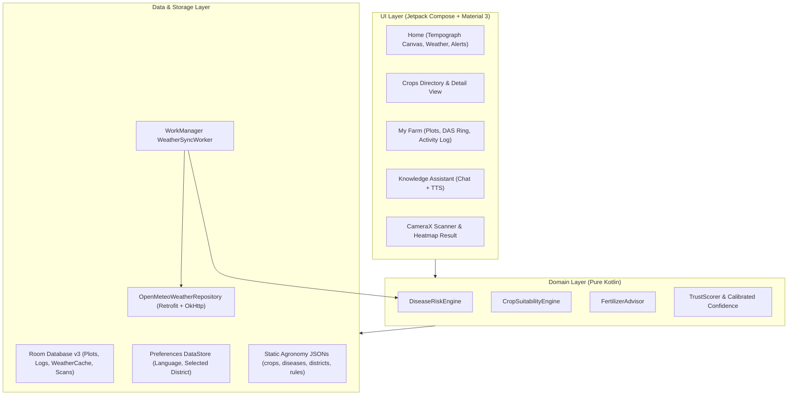

# AgroDoc (ಅಗ್ರೋಡಾಕ್)

<div align="center">

-3DDC84?style=flat&logo=android&logoColor=white)
-blue?style=flat)

-4285F4?style=flat&logo=jetpackcompose&logoColor=white)
-FF6F00?style=flat&logo=tensorflow&logoColor=white)


**An intelligent, offline-first & connected agronomy platform empowering farmers across Karnataka and India with real-time weather risk analytics, on-device disease diagnosis with Grad-CAM explainability, plot tracking, and multilingual assistance.**

[Key Features](#key-features) • [Architecture](#architecture) • [Product Flavors](#product-flavors) • [Screenshots](#screenshots) • [Getting Started](#getting-started) • [Documentation](#documentation)

</div>

---

## 🌾 Overview

**AgroDoc** is tailored for the realities of rural agriculture: variable cellular connectivity, extreme weather shifts, and diverse linguistic needs. The platform delivers actionable agronomic intelligence straight into the farmer's hands in **Kannada (ಕನ್ನಡ)**, **Hindi (हिन्दी)**, **Marathi (मराठी)**, and **English**, validated against official packages of practices from **University of Agricultural Sciences (UAS) Bengaluru, Dharwad, Raichur, and ICAR**.

---

## ✨ Key Features

### 1. 🌦️ Live Open-Meteo Weather & 14-Day Tempograph Canvas
- **Hyper-Local Forecasts**: Live 7-day forecasts and current meteorological observations across 84 administrative districts (with all 31 Karnataka districts prioritized).
- **Custom Canvas Tempograph (`TempographChart.kt`)**: Custom Jetpack Compose Canvas visualization rendering:
  - Smooth cubic Bézier min-to-max temperature ribbons.
  - Precipitation vertical bars color-coded by rainfall intensity.
  - Interactive touch scrubbing with dashed inspection guidelines and tooltip readouts.
  - Clear "Today" demarcation line separating historical records from 7-day predictions.
- **Leaf-Wetness Duration Proxy**: Computes consecutive hours of relative humidity $\ge 90\%$ to identify periods vulnerable to fungal sporulation.

### 2. 🛡️ Weather-Informed Disease Risk Engine (`DiseaseRiskEngine.kt`)
- Evaluates 7-day meteorological forecasts against verified epidemiological thresholds stored in agronomy rules.
- Computes risk levels (**HIGH**, **MODERATE**, **LOW**) for crops in the farmer's active profile with localized explanations.
- Acts as a secondary signal on the Result screen to guide farmers without overriding machine learning image models.

### 3. 🌿 Karnataka Crops Directory (26 Crops)
- Deep agronomic profiles covering 8 agricultural categories: Cereals, Millets, Pulses, Oilseeds, Vegetables, Fruits, Plantation, and Cash crops.
- Detailed parameters: sowing/transplanting windows, temperature/water requirements, soil types, optimal pH ranges, Karnataka agro-climatic zones, and growth stage timelines.
- Filter chips by Season (Kharif, Rabi, Summer, Perennial), Water Need, and Region.

### 4. 🔬 Disease Pathology & Chemical/Biological Treatments (36 Diseases)
- 36 major diseases affecting Karnataka crops (Paddy Blast, Ragi Blast, Sugarcane Red Rot, Cotton Leaf Curl, Tomato Early/Late Blight, Arecanut Koleroga, Coffee Quick Wilt, etc.).
- Symptoms, causal organisms, favorable weather conditions, cultural prevention, and certified active chemical ingredients with dosage per acre and pre-harvest intervals (PHI).

### 5. 🚜 My Farm Management & Activity Timeline (Room v3)
- **Plot Management**: Configure field plots with custom area units (Acre, Guntha, Hectare), sowing dates, soil types, and irrigation methods.
- **Days After Sowing (DAS) Ring Gauge**: Visual progress ring indicating current growth stage based on the crop duration timeline.
- **FarmLog Timeline**: Record farming operations (`SOWING`, `FERTILIZER`, `IRRIGATION`, `SPRAY`, `OBSERVATION`, `HARVEST`) with costs and notes.
- **One-Click CSV Export**: Exports complete plot and activity logs directly via the Android System Share Sheet (`Intent.ACTION_SEND`).

### 6. 💬 Multilingual Knowledge Assistant with Text-To-Speech
- **Tier A (Offline)**: Pure Kotlin BM25 indexing over bundled agronomic knowledge assets.
- **Tier B (Connected)**: Online fallback advisory for conversational agronomy assistance.
- **Hands-Free Audio**: Full Android `TextToSpeech` (TTS) read-aloud support in Kannada, Hindi, Marathi, and English.

### 7. 📸 LiteRT Plant Disease Scanner & Trust Rating
- Center-cropped CameraX viewfinder and gallery image picker.
- On-device Grad-CAM heatmap visualization highlighting salient diagnostic leaf regions.
- Calibrated 3-tier Trust Rating (High, Medium, Low) powered by temperature-scaled logits, top-2 probability margins, and out-of-distribution detection.
- Graceful missing model fallback directing farmers to the manual disease library.

---

## 📱 Product Flavors & Privacy Architecture

AgroDoc provides two product flavors configured under the `network` Gradle dimension:

| Feature / Guarantee | `connected` Flavor (Default) | `offline` Flavor |
|:---|:---:|:---:|
| **Package Name** | `com.agrodoc.app` | `com.agrodoc.app.offline` |
| **Network Access** | `INTERNET`, `ACCESS_NETWORK_STATE` | ❌ **0 Network Permissions** (Strict Air-Gap) |
| **Location Access** | `ACCESS_COARSE_LOCATION` (Optional) | ❌ **No Location Permissions** |
| **Notifications** | `POST_NOTIFICATIONS` (Disease Alerts) | ❌ None |
| **Weather Fetch** | Live Open-Meteo REST API + 6-hour Room cache | Inert `NoOpWeatherRepository` |
| **Background Sync**| AndroidX `WorkManager` 6-hour periodic sync | Disabled |
| **Leaf Scans & Photos**| **100% On-Device** (Never sent to cloud) | **100% On-Device** (Never sent to cloud) |
| **Farm Plots & Logs** | **100% Private Local SQLite** | **100% Private Local SQLite** |

---

## 🏛️ System Architecture

AgroDoc follows Android Clean Architecture principles with unidirectional data flow:



---

## 🗂️ Project Structure

```
AgroDoc/
├── app/
│   ├── src/
│   │   ├── main/
│   │   │   ├── assets/
│   │   │   │   ├── districts.json                    # 84 District coordinates (31 Karnataka first)
│   │   │   │   └── knowledge/
│   │   │   │       ├── crops.json                    # 26 Karnataka crops in 4 languages
│   │   │   │       ├── disease_info.json             # 36 Pathogens with chemical & bio cures
│   │   │   │       ├── disease_risk_rules.json       # Favorable weather thresholds
│   │   │   │       ├── fertilizer_rules.json         # University NPK splits & product math
│   │   │   │       └── glossary.json                 # 12 Agronomic terms in 4 languages
│   │   │   ├── java/com/agrodoc/app/
│   │   │   │   ├── data/                             # Room entities, DAOs, Migrations, Repositories
│   │   │   │   ├── domain/                           # Pure Kotlin engines, models, interfaces
│   │   │   │   ├── ml/                               # LiteRT ModelRunner, CamGenerator, TrustScorer
│   │   │   │   └── ui/                               # Compose Screens, Navigation, ViewModels, Theme
│   │   │   └── res/                                  # Multilingual strings (values, kn, hi, mr)
│   │   ├── connected/                                # Live Open-Meteo REST API, WorkManager, Notifier
│   │   ├── offline/                                  # NoOpWeatherRepository (0 network dependencies)
│   │   └── test/                                     # Unit test suites (20 tests, 100% passed)
├── docs/                                             # Architecture Decisions (ADR), Privacy, Test Plan
├── ml/                                               # Training pipeline, dataset ledger, Colab notebook
└── README.md
```

---

## 🚀 Getting Started

### Prerequisites
- **Android Studio Ladybug (2024.2+)** or newer.
- **Android SDK 35** (Platform tools, Build tools 34.0.0+).
- **JDK 17 or JDK 21**.

### Clone & Open
```bash
git clone https://github.com/mustafizkhan987/AgroDoc.git
cd AgroDoc
```

### Local Setup
1. Copy `local.properties.example` to `local.properties`:
   ```bash
   cp local.properties.example local.properties
   ```
2. Set your `sdk.dir` in `local.properties`:
   ```properties
   sdk.dir=C\:\\Users\\<YourUsername>\\AppData\\Local\\Android\\Sdk
   ```

### Building & Running
To assemble and install the **default connected app** on your connected device/emulator:
```bash
# Run unit tests
./gradlew testConnectedDebugUnitTest

# Build Debug APK (40.4 MB)
./gradlew assembleConnectedDebug

# Build Optimized Release APK with R8 Minification (22.3 MB)
./gradlew assembleConnectedRelease

# Install directly via adb
adb install -r app/build/outputs/apk/connected/debug/app-connected-debug.apk
```

To build the strictly air-gapped **offline APK**:
```bash
./gradlew assembleOfflineDebug
```

---

## 🧪 Testing & Quality Assurance

AgroDoc includes comprehensive JVM unit tests covering manifest permission isolation, agronomy logic, and asset parsing:

| Test Suite | File | What it Validates |
|:---|:---|:---|
| **Permission Assertions** | `OfflineManifestTest.kt` | Asserts 0 network permissions in offline build |
| **Fertilizer Advisor** | `FertilizerAdvisorTest.kt` | Tests Acre/Guntha/Hectare conversions and $\pm 25\%$ soil adjustments |
| **Crop Suitability** | `CropSuitabilityEngineTest.kt`| Tests climate and soil matching algorithms |
| **Disease Weather Risk** | `DiseaseRiskEngineTest.kt` | Tests consecutive and cumulative temperature/humidity/rain rules |
| **Trust Scorer** | `TrustScorerTest.kt` | Tests temperature-scaled logits and out-of-distribution rejection |
| **Asset Validation** | `KnowledgeAssetValidationTest.kt`| Parses all 26 crops, 36 diseases, and 84 districts |

---

## 📚 Documentation Index

- [Final Implementation Report](docs/FINAL_REPORT.md) — Comprehensive technical delivery report.
- [Architecture Decisions (ADRs)](docs/DECISIONS.md) — Full ledger of architectural decisions (ADR-001 through ADR-012).
- [Model Card](docs/MODEL_CARD.md) — Model architecture, LiteRT runtime, calibration, and safety caveats.
- [Privacy Policy & Guarantees](docs/PRIVACY.md) — Privacy-by-design guarantees and data storage scope.
- [Test Plan](docs/TEST_PLAN.md) — Full QA test plan and verification procedures.
- [Agronomy Review Checklist](docs/AGRONOMY_REVIEW.md) — University verification criteria for field deployment.
- [ML Dataset Ledger](ml/DATASETS.md) — Dataset licenses and class mapping.

---

## 📄 License & Attribution

- **Weather Data**: Forecast and historical weather data provided by [Open-Meteo.com](https://open-meteo.com) under [CC BY 4.0](https://creativecommons.org/licenses/by/4.0/).
- **Agronomic Knowledge**: Package of practices adapted from UAS Bengaluru, UAS Dharwad, and ICAR extension publications.
- **Plant Pathology Imagery**: PlantVillage dataset under CC BY-SA 4.0.
